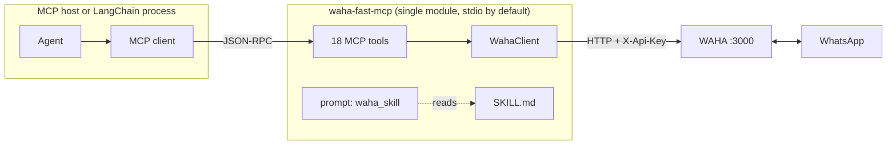

# waha-fast-mcp

A fast, single-module [MCP](https://modelcontextprotocol.io) server that exposes
a local [WAHA](https://waha.devlike.pro/) (WhatsApp HTTP API) instance as tools
for MCP hosts and LangChain agents.

It is a conservative simplification of `waha-langchain-mcp`: the HTTP client and
the tool layer live in one `server.py`, the 18 tool contracts are unchanged, and
the operational guide is shipped as `SKILL.md` and exposed through the
`waha_skill` MCP prompt.



## Tools

| Area | Tools |
| --- | --- |
| Sessions | `waha_status`, `waha_list_sessions`, `waha_get_session`, `waha_get_me`, `waha_start_session`, `waha_stop_session`, `waha_create_session` |
| Chats and messages | `waha_list_chats`, `waha_get_chat`, `waha_get_chat_messages`, `waha_mark_chat_read`, `waha_set_typing`, `waha_take_screenshot` |
| Sending | `waha_send_text`, `waha_send_image`, `waha_send_file` |
| Contacts | `waha_check_number_exists`, `waha_get_profile_picture` |

Prompt: `waha_skill` returns [`SKILL.md`](./SKILL.md), which documents the
lifecycle, chat ID formats, send guardrails, media rules, and error handling.

Inbound messages are not pushed over MCP. Point a WAHA webhook at your
application for inbound automation.

## Setup

```bash
cd /home/user/Projects/aegra-content/waha-fast-mcp
uv sync --extra dev --extra examples
cp .env.example .env
```

Set `WAHA_API_KEY` in `.env`. The server reads `WAHA_BASE_URL`,
`WAHA_API_KEY`, and `WAHA_TIMEOUT`.

Verify the server and the live WAHA connection:

```bash
uv run python -m waha_fast_mcp --pretty
uv run pytest
```

`--pretty` prints the tool catalog as JSON and exits without starting a server.
`pytest` runs without WAHA; live tests are opt-in with `WAHA_LIVE=1`.

## Use with an MCP host

```json
{
  "mcpServers": {
    "waha": {
      "command": "uv",
      "args": [
        "run",
        "--directory",
        "/home/user/Projects/aegra-content/waha-fast-mcp",
        "waha-fast-mcp"
      ],
      "env": {
        "WAHA_BASE_URL": "http://localhost:3000",
        "WAHA_API_KEY": "<your-key>"
      }
    }
  }
}
```

The server defaults to stdio. Optional SSE or streamable HTTP:

```bash
WAHA_MCP_TRANSPORT=streamable-http uv run waha-fast-mcp
```

## Use with LangChain

The examples spawn `python -m waha_fast_mcp` over stdio and pass the API key in
the child process environment, never to the model.

```bash
uv run python examples/list_tools.py
uv run python examples/react_agent.py "Show my 5 most recent chats"
uv run python examples/deep_agent.py "Summarize my unread chats"
```

Minimal wiring:

```python
from langchain_mcp_adapters.client import MultiServerMCPClient

client = MultiServerMCPClient({
    "waha": {
        "command": "python",
        "args": ["-m", "waha_fast_mcp"],
        "transport": "stdio",
        "env": {"WAHA_BASE_URL": "http://localhost:3000", "WAHA_API_KEY": "..."},
    }
})
tools = await client.get_tools()
```

## Security

- Keep `WAHA_API_KEY` in the environment or `.env`; it is never a tool argument.
- Sending messages and starting/stopping sessions are real side effects. Require
  explicit user intent and a human gate where the host supports one.
- `waha_send_image` / `waha_send_file` accept local paths, so the stdio server
  can read files with the agent process's permissions.
- `SKILL.md` is advisory. Hard requirements, such as blocking sends to protected
  chats, must be enforced by a host permission rule or hook.
- The default transport is stdio. If you expose HTTP, bind to localhost and add
  authentication.

## Documentation

- [Intent](./docs/intent.md)
- [Design](./docs/design.md)
- [Spec](./docs/spec.md)
- [Plan](./docs/plan.md)
- [Testing](./docs/testing.md)
- [Review](./docs/review.md)
- [Operational skill](./SKILL.md)

## License

MIT. See [`LICENSE`](./LICENSE).
