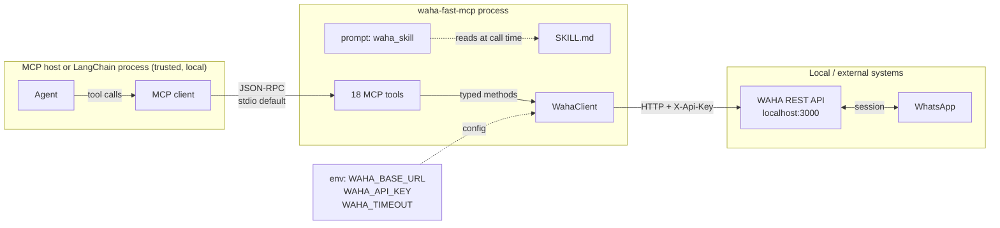

# Design: waha-fast-mcp

Status: accepted for P0-P5. Input: [docs/intent.md](./intent.md).

## 1. Current-state assessment

The source project `../waha-langchain-mcp` was reviewed before this build.

| Area | Current state | Assessment |
| --- | --- | --- |
| Server | `src/waha_mcp/server.py`, 18 tools, `FastMCP` | Behavior is correct and worth preserving |
| Client | `src/waha_mcp/client.py`, 235 lines | Extra module boundary for a fixed REST API; one class, no reuse elsewhere |
| Tool style | Each tool calls `_client()` and enters an async context | Clear, but repeated construction and cleanup |
| Agent guidance | Tool docstrings only; no `SKILL.md` or prompt | Agents must infer lifecycle, ID formats, and send risk |
| Tests | None | No regression path; no evidence for review |
| Docs | `docs/decisions/` + `docs/diagrams/`; README links to a missing path | Broken navigation; no intent/spec/plan/testing/review chain |
| Packaging | Hatchling, `src/` layout, console script | Correct; keep the pattern |
| Examples | ReAct, deep agent, tool listing | Keep, update the module name |
| Dependencies | Duplicate `langchain` entry | Clean up in the new project |

The target directory contained only a reference copy of
`chrome-agent-mcp-light`. It had no package, server, tests, or docs.

## 2. Target architecture

### Design principles

1. **One module for one integration.** The HTTP client, validation helpers,
   tool definitions, prompt, and CLI entry point live in `server.py`.
2. **Preserve the contract.** Tool names, parameters, defaults, and compact
   response shapes are copied from `waha-langchain-mcp`.
3. **Guide the agent explicitly.** `SKILL.md` is the operational contract and is
   retrievable at runtime through the `waha_skill` prompt.
4. **Stateless.** Every tool call carries the WAHA session; WAHA and WhatsApp own
   the state.
5. **Test without WhatsApp.** Inject `httpx.MockTransport` into `WahaClient` so
   the full tool path is testable offline.

## 3. Components

### 3.1 `server.py`

- `WahaClient`: async HTTP wrapper for the endpoints used by the 18 tools, with
  optional injected transport and bounded timeout.
- `WahaError`: one error type for transport failures and non-2xx responses.
- Compactors: `_jid`, `_compact_chat`, `_compact_message`.
- Media validation: `_file_payload` enforces exactly one of `url`, `path`, or
  `data_base64`.
- 18 `@mcp.tool()` functions with the existing signatures.
- `waha_skill` `@mcp.prompt()` that reads `SKILL.md` with a safe fallback.
- `main()` with `--transport` and `--pretty`.

### 3.2 `SKILL.md`

The agent-facing guide. Sections: safety rules, lifecycle, chat ID formats,
reading, sending, media, session administration, contacts/screenshots, errors,
response style, tool table, and out of scope.

It is the single source of truth for operational guidance. It is not a security
control.

### 3.3 Packaging

- `src/waha_fast_mcp/` is the import package.
- `SKILL.md` stays at the repository root and is force-included into the wheel as
  package data.
- The runtime lookup checks the repo root first (editable/source use), then the
  installed package directory.
- Console script: `waha-fast-mcp = "waha_fast_mcp.server:main"`.
- Module entry point: `python -m waha_fast_mcp`.

### 3.4 Examples

`examples/` is carried over with only the child-process module name changed from
`waha_mcp` to `waha_fast_mcp`.

## 4. Key design decisions

| Decision | Choice | Rationale |
| --- | --- | --- |
| Client boundary | Merge `client.py` into `server.py` | One module, one owner; no second import surface |
| Tool surface | Keep all 18 tools | Conservative; avoids breaking prompts and examples |
| Generic pass-through | Not added | Fixed API; agent safety and discoverability stay better with named tools |
| Agent guide | `SKILL.md` + `waha_skill` prompt | Matches the proven chrome-agent pattern |
| Transport | stdio default; SSE/HTTP optional | Keeps the API key local; preserves host flexibility |
| SDK | `FastMCP` from `mcp.server.fastmcp`, `mcp` 1.x | Working API; compatible with `langchain-mcp-adapters` |
| Test injection | `httpx.MockTransport` on `WahaClient` | Exercises tools without WAHA or WhatsApp |
| Python floor | `>=3.10` | Preserves the source project's compatibility |

## 5. Non-functional requirements

- **Latency:** one HTTP round-trip per tool call, bounded by `WAHA_TIMEOUT`
  (default 30s).
- **Reliability:** transport errors and non-2xx responses raise `WahaError` with
  method, path, status, and a truncated body.
- **Security:** no secret in tool arguments; no secret logging; local media paths
  are a documented trust boundary; `SKILL.md` safety rules are advisory.
- **Observability:** error messages include the HTTP method and path. Tool
  responses are compact and human-readable.
- **Portability:** Linux/macOS first; WAHA may be local or remote via
  `WAHA_BASE_URL`.
- **Context economy:** compact chat/message projections instead of raw WAHA
  payloads; paging via `limit`/`offset`.

## 6. Risks and mitigations

| Risk | Impact | Mitigation |
| --- | --- | --- |
| Agent sends without consent | Irreversible user-visible action | `SKILL.md` rules, explicit-intent system prompts, host human gate |
| 18 tools bloat context | Higher token use, weaker selection | Short docstrings, grouped guide, evals on tool choice |
| Local path read via media tools | File disclosure to the server / WhatsApp | Documented trust boundary; only user-supplied paths |
| `SKILL.md` drifts from tools | Agent follows stale guidance | Prompt test asserts file presence; review checklist requires sync |
| No live WAHA in CI | Integration gaps | Mocked unit tests by default; opt-in `WAHA_LIVE=1` suite |
| HTTP transport exposed | Unauthenticated access to WhatsApp | stdio default; localhost bind and auth guidance |

## 7. Governance

- **Human gates:** merging to main, releasing, adding a generic request tool,
  exposing HTTP transport, and changing send behavior require a code-owner.
- **Advisory vs. deterministic:** `SKILL.md` is advisory. Any hard block, such as
  a protected-chat allowlist, must be a host permission rule or hook.
- **Separation of duties:** the agent may review a PR but never approves or merges
  its own change.
- **Evidence:** each stage commits an artifact; tests and the review record are
  the evidence for P4.
